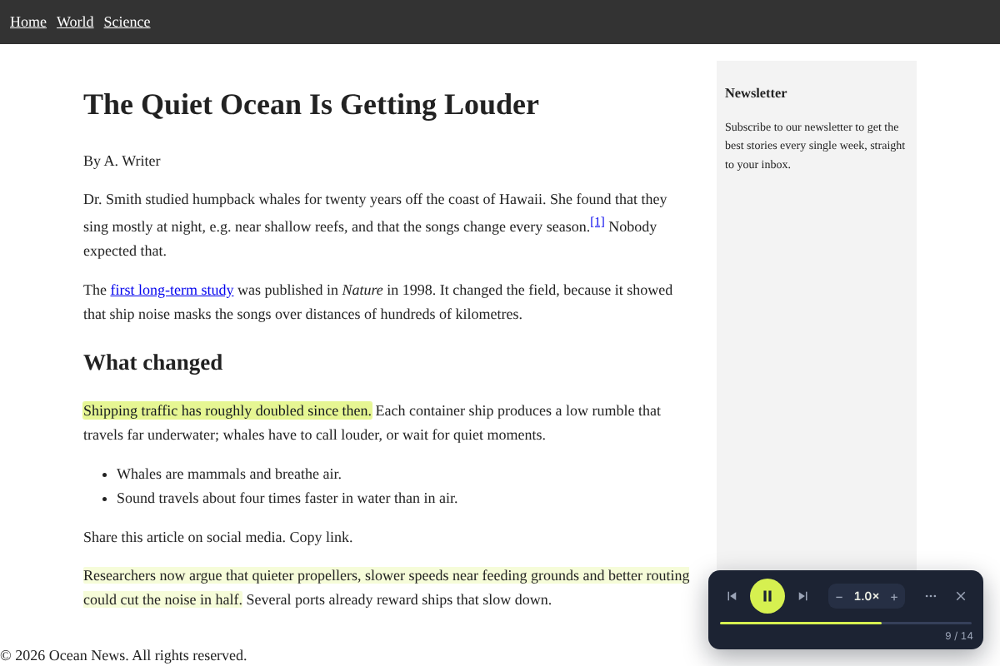
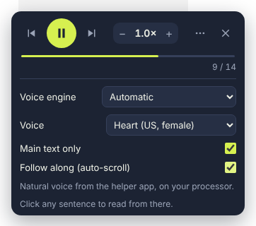
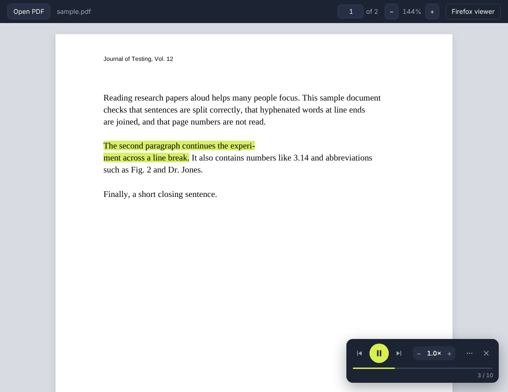

# Humanly Text to Speech

**A read-aloud add-on for Firefox** with a natural, human-sounding voice that runs on your own computer.
It reads web pages and PDFs, highlights each sentence as it goes, and lets you click any sentence to
jump there. No account, no cloud, no tracking.

> **Firefox only.** Humanly is built for Firefox on the desktop (version 140 or newer) and uses
> Firefox-specific add-on features, so it doesn't run in Chrome, Edge or Safari. The optional voice
> helper that makes the natural voice fast is for Windows.

## Features

- **Click to jump.** Click any sentence and reading continues from there. The current sentence is
  highlighted and the page scrolls along with it.
- **Natural voice, offline.** 16 English voices (US and UK) from the [Kokoro](https://huggingface.co/hexgrad/Kokoro-82M) model. Everything is generated locally.
- **Reads the article, not the clutter.** Menus, sidebars, ads, share buttons, comments and citation
  marks like `[1]` are skipped. Turn off "Main text only" in the menu to read the whole page.
- **PDFs.** PDF links open in a built-in viewer with the same highlighting and click-to-jump. It joins
  words hyphenated across lines, keeps headings separate, and skips running headers, footers and
  page numbers. It also repairs PDFs whose text is scrambled internally (the page looks fine but other
  readers only say the first letter of each word).
- **Player.** Previous/next sentence, play/pause, speed from 0.5× to 2×, voice choice, and a progress
  line you can click. Next sentences are prepared while you listen, so reading is continuous.
- **Read from here.** Select text, right-click, **Read aloud from here**. Keyboard shortcut: **Alt+Shift+R**.

| Player | PDF viewer |
| --- | --- |
|  |  |

## Install

You need **Firefox 140 or newer** on Windows, macOS or Linux. The natural voice is fastest on Windows
with the voice helper (step 2).

### 1. The add-on

Download `humanly-tts-<version>.xpi` from the [latest release](https://github.com/utrox/humanly-text-to-speech/releases/latest) and drag it
onto a Firefox window.

> Firefox only installs signed add-ons permanently. Release files are signed. If you build the add-on
> yourself, see [CONTRIBUTING.md](CONTRIBUTING.md#trying-your-build) for how to load or sign it.

### 2. The voice helper (Windows, recommended)

Firefox limits add-ons to one processor core per worker, which makes the natural voice slow inside
the browser (around 30 seconds per sentence). The helper runs the same voice outside Firefox using all
your processor cores, so a sentence takes about a second.

1. Download `humanly-tts-helper.zip` from the [latest release](https://github.com/utrox/humanly-text-to-speech/releases/latest) and unzip it.
2. Double-click `install.bat`. No admin rights are needed. It sets up Python if it's missing,
   downloads the voice model (about 350 MB, checked against known fingerprints), and plays a test
   sentence.
3. Restart Firefox.

To remove it, run `uninstall.bat`. Details are in [helper/README.txt](helper/README.txt).

Without the helper, the add-on uses the voices built into Windows: instant, but less natural.

## Using it

- **Web pages:** click the toolbar button (or press Alt+Shift+R), then press play or click a sentence.
- **PDFs:** open any PDF link. For a file on your computer, right-click the toolbar button and choose
  **Open a PDF file in the reader…**, or drop the file onto the viewer.
- **Settings:** the **⋯** button in the player has the voice engine, voice, "Main text only" and
  "Follow along". The add-on's options page (about:addons) has PDF handling and the helper status.

### Voice engines

| Engine | Sound | Speed | Setup |
| --- | --- | --- | --- |
| Natural voice (helper app) | Natural | About 1 s per sentence | Run `install.bat` once (Windows) |
| Windows voice | Robotic | Instant | None |
| Natural voice in Firefox | Natural | About 30 s per sentence | None (downloads ~90 MB on first use) |

**Automatic** (the default) uses the helper when it's installed and the Windows voice otherwise.

The helper tries the graphics card first (DirectML) and falls back to the processor when the card
can't run the model or produces noise. The player's status line says which one is in use.

## Privacy

Nothing you read leaves your computer. The add-on has no analytics and no accounts. The only
network requests are the one-time voice model download and fetching PDFs you open.
See [PRIVACY.md](PRIVACY.md).

## Troubleshooting

- **The status line says "Windows voice" although the helper is installed.** Restart Firefox, then
  open the add-on's options and click **Check again**. If it still fails, run the helper's self-test
  (see [helper/README.txt](helper/README.txt)) and include its output in an issue.
- **A page can't be read.** Firefox doesn't allow add-ons on its own pages (about:, the add-ons store).
- **A PDF has no readable text.** Scanned PDFs are images; the reader has no OCR.
- **Something else.** [Open an issue](https://github.com/utrox/humanly-text-to-speech/issues/new/choose) with your Firefox version, the page or
  PDF (if public), and the text in the player's status line.

## Contributing

Bug reports and pull requests are welcome. [CONTRIBUTING.md](CONTRIBUTING.md) covers building,
testing, how the code is organised, and making a release.

## License

GPL-3.0-or-later (see [LICENSE](LICENSE)). The add-on includes eSpeak NG, which is GPL-3.0, and other
open-source components listed in [THIRD_PARTY_NOTICES.md](THIRD_PARTY_NOTICES.md).
